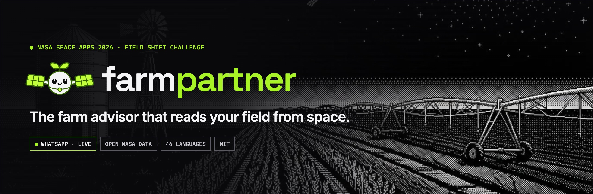

<p align="center"><a href="https://farmpartner.space"></a></p>

**The farm advisor that reads your field from space.** A WhatsApp and SMS advisor built on open NASA Earth data,
for NASA Space Apps 2026, challenge *Field Shift: Adapting Farms with NASA Data*.

**Try it:** [farmpartner.space](https://farmpartner.space). Enter your WhatsApp number and FarmPartner messages you
first, or text "hi" to **+1 620 318 1728** on WhatsApp, or use the [browser simulator](https://farmpartner.space/chat),
or open a [sample field report](https://farmpartner.space/sample).

A farmer sends a location pin. FarmPartner reads 20 years of NASA climate, soil-moisture and vegetation data for that
field, and the field's crop history from USDA satellite crop maps. It then compares the farmer's **current rotation
with two alternatives** that fit their climate, water and goals. Each strategy says *why* it was suggested, the
*evidence* (with its source), *benefits*, *information gaps* and *risks* to check locally, plus the yield gain that
3,663 field trials predict and the long-term experiments nearby that have run it for decades.

After onboarding the farmer just keeps talking, in their own language, by text, voice note or photo: "should I water
this week?", "frost coming?", "got 1 inch of rain", "what cover crop after wheat?". What they report is stored as
ground truth next to the satellite data.

> FarmPartner supports, and does not replace, farmer judgment and local agronomic expertise.

## The site

| Page | What's on it |
|---|---|
| [`/`](https://farmpartner.space) | Landing page: WhatsApp phone opt-in, channels, explainer video |
| [`/what-and-how`](https://farmpartner.space/what-and-how) | What FarmPartner does and how: data, AI and farmers, with a sample report |
| [`/data-and-science`](https://farmpartner.space/data-and-science) | Every source it reads, what each one is used for, and what the data can't see |
| [`/limits`](https://farmpartner.space/limits) | The known limits, what they mean for a farmer, and what would close each gap |
| [`/team`](https://farmpartner.space/team) | The six builders |
| [`/chat`](https://farmpartner.space/chat) | WhatsApp-style web simulator, the same bot without a phone |
| [`/r/<id>`](https://farmpartner.space/sample) | The field report (below) |

**The field report** is mobile-first, because most farmers open it from WhatsApp on their phone. It starts with the
bottom line: the best fit for the farmer's goals, today's score versus that plan, and the biggest gain. Then the
field (satellite map, rain, water balance, crop stress), the three strategies with their year-by-year crop timelines
and seven sub-scores, the water and vegetation charts (rain vs evaporation demand by month, NDVI with the longest
bare-soil stretch marked), and the field's crop history, soil, the farmer's own reports and the blind spots. Every
bar, month and data point shows its numbers on hover, or on tap on a phone.

The look is dark with a lime accent (Space Grotesk, Inter, IBM Plex Mono), with pixel-art farm scenes and Orbi, a
satellite with a sprout, as the mascot and WhatsApp profile picture. Designs live in a Pencil file; templates in
`app/templates/`.

## Talking to it

Every onboarding choice is a WhatsApp tap-button or list. The same prompts arrive as numbered text over SMS.

```
FarmPartner: 👋 Hi! I'm FarmPartner… [Get started] [Not now]      ← approved template, after the web opt-in
Farmer:      Get started
FarmPartner: 📍 Step 1 of 3: send your field location (📎 → Location)
Farmer:      📍 (pin)
FarmPartner: 🛰️ Here's what NASA sees at Finney County, KS: ~21.5 in rain vs ~51 in evaporation demand,
             48 days >95°F a year lately (was 45) · water storage falling 0.34 in/yr since 2002 (GRACE) …
             Satellite crop maps show 2021 fallow, 2022 wheat, 2023 sorghum…
             Step 2 of 3 — is that your rotation?  [Yes, irrigated] [Yes, dryland] [Different crops]
Farmer:      Yes, dryland
FarmPartner: Step 3 of 3 — what matters most?  [Choose a goal ▾] Save water · Soil health · Income · Less erosion ·
             Forage · Something else (type your own)
Farmer:      Build soil health
FarmPartner: Today: Wheat → Sorghum → Fallow — 48/100
             Option 1: Wheat + summer cover → Sorghum — 69/100 · Better soil health (+43) · ⚠️ check sorghum buyers
             📚 Trials: the crop after a legume yields ~23% more · ✅ Tested since 1981 at Lincoln, NE
             Option 2: …  Full report: https://farmpartner.space/r/<id>
             [Should I water?] [Frost coming?] [My field report]
```

- **Any location format.** A pin, a Google/Apple Maps link, decimal or degree-minute-second coordinates
  (`31°45'12"N 42°18'34"E`), a ZIP or foreign postcode, or a town name ("I live near Bilbao"). Pins on open sea
  (elevation 0.0 m) or on water and towns in the crop maps are caught and the farmer is asked again. Greetings are
  never looked up as places.
- **Any language.** The farmer writes in their language and onboarding, buttons and the report link follow it:
  45+ languages, with Spanish (secano/regadío, *usted*), Basque, Catalan and Galician tuned by our testers. Units
  switch to metric outside the U.S.
- **Any crop, any goal.** Crops named in any language or shown in a photo; tree crops set up as orchards; several
  goals, or a goal in the farmer's own words.
- **Voice notes** are transcribed (Google Speech-to-Text) and answered like text.
- **Later on:** watering, frost and heat questions use the 7-day forecast plus SMAP soil moisture and ECOSTRESS crop
  stress; daily alerts; observations (rain gauges, pests, plantings, yields) are logged.

About 20–30 minutes after onboarding, the field's SMAP and ECOSTRESS results come in from NASA AppEEARS and are added
to the report and the watering advice.

## Data sources

The full list, with what each source feeds, is on [/data-and-science](https://farmpartner.space/data-and-science)
(content in `app/sources.py`).

| Source | Used for | Access |
|---|---|---|
| **NASA POWER** daily (MERRA-2 T2M_MAX/MIN, PRECTOTCORR, GWETROOT) | 20-yr rainfall, evaporation demand (Hargreaves ET₀), frost dates, growing degree days, heat-stress trend, heavy-rain days, root-zone soil wetness anomaly | REST, no key |
| **NASA MODIS MOD13Q1** NDVI 250 m (ORNL DAAC) | Months the field is bare (the cover-crop window), crop vigor timeline | REST, no key (slow, fetched in background) |
| **NASA SMAP L4** (SPL4SMGP, 9 km) via AppEEARS | Root-zone and surface soil moisture over the last 120 days and its monthly trend: "25% water by volume, up from 18% in July" | Earthdata login; async job per field |
| **NASA ECOSTRESS** ESI (ECO_L4T_ESI, 70 m) via AppEEARS | Field-scale crop water stress (actual vs. potential evapotranspiration) over the last year | Earthdata login; async job per field |
| **NASA GRACE/GRACE-FO** JPL mascon RL06.3 | Long-term water-storage (groundwater) trend in in/yr, a key Ogallala risk signal | Precomputed grid in `data/grace_trends.csv` (`scripts/get-grace.sh` + `precompute_grace.py`) |
| **USDA NASS Cropland Data Layer** 30 m, 2017–2025 | Crop history per year → auto-detects the current rotation; flags pins on water or towns | REST, no key |
| **USDA NRCS SSURGO** (Soil Data Access) | Organic matter, texture, slope, erodibility (K), drainage | REST, no key |
| **Mudare et al. 2025**, *Nature Communications* 16:9552 — meta-analysis of 3,663 field trials | Expected yield gain of each crop from its pre-crop (+23 % after legumes, +16 % after other crops, 0 in monoculture), legume N savings (41–46 %); feeds the income score and the 📚 lines | `app/engine/research.py` |
| **DRIVES** long-term rotation experiments (drives-network.org) | "✅ Tested since 1981 at Lincoln, NE": rotations run for decades at 22 sites in the U.S., Canada and Mexico near the field | `data/drives_sites.json` (experiment metadata; cite the DRIVES repository) |
| **FAOSTAT** crops (FAO, 2020–24, CC BY-NC-SA 3.0 IGO) | What each country actually grows: the main crops shown outside the U.S., and the only crops the rotation search may use there | `data/fao_country_crops.csv` (built by `scripts/build_reference_data.py`) |
| **Agronomy library**: SARE handbooks, Best4Soil, UNLP, La Fertilidad de la Tierra | 2,991 page-tagged passages the agent searches (BM25) and cites by title and page for how-to questions | Built by `scripts/build_library.py` into the private cache bucket; the publications are not in this repo |
| Open-Meteo forecast, elevation and geocoding | 7-day rain, ET₀, frost and heat for alerts and irrigation advice; open-sea check; town names → coordinates | REST, no key |
| GeoNames towns (CC BY 4.0), U.S. Census geocoder, Zippopotam | Pin → country offline, county names, postal codes → location | `data/country_points.csv`; REST, no key |

Only derived features are stored, never raw rasters.

## How it works

```
farmpartner.space ─► phone opt-in ─► POST /api/optin ─► Twilio Content API: approved welcome template
WhatsApp / SMS ─► Twilio ─► POST /twilio/webhook (acks at once, replies via the API) ─► app/chat.py
                                 ├─ media.py        voice notes → Speech-to-Text; photos → Claude
                                 ├─ i18n.py         language detection and translation (fast model, cached)
                                 ├─ onboarding.py   location (pin/link/coords/postcode/place) → confirm crops → goals
                                 └─ agent.py        Claude Opus 5.5 with 7 tools + web search, or a keyword fallback
                     service.py ──► engine/features.py   (NASA/USDA fetchers in parallel)
                                ──► data/appeears.py     (SMAP + ECOSTRESS async jobs, collected in the background)
                                ──► engine/scoring.py    (rule-based scoring; rotation search beyond the templates)
                                ──► engine/research.py   (meta-analysis effects, DRIVES sites nearby)
                                ──► engine/explain.py    (why / evidence / benefits / gaps / risks, farmer's units)
                                ──► library.py           (agronomy library search)
                                ──► db.py                (Supabase Postgres: farmer, field, crop_history, observation,
                                                          recommendation, message, alert)
data/http.py  two-level raw-data cache: /tmp → Cloud Storage bucket (survives restarts and deploys)
Cloud Scheduler 06:00 CT ─► POST /internal/daily (OIDC): frost/heat/irrigation alerts, refresh week-old fields,
                                                         collect finished satellite jobs
GET /r/<id>  field report (report_view.py derives the bottom line, water gap, bare-soil run, tooltips)
```

**The agent's tools:** `get_field_conditions`, `compare_rotations`, `irrigation_advice`, `weather_outlook`,
`log_observation`, `update_farm_profile` and `search_library`, plus Anthropic's web search as a last resort, with
sources. Claude only rephrases what the tools return and never invents numbers. A fast model (Claude Haiku 5.5)
translates scripted messages; prompts are cached, and the WhatsApp typing indicator shows while a reply is built.

**Scoring is deterministic and explainable.** `seeds/crops.json` holds 22 crops and 6 cover crops with their traits:
water need, drought and heat tolerance, nitrogen fixing, rooting depth, residue, pests, planting and harvest months.
`seeds/rotations.json` holds 28 rotation templates, and the search also tries every 2- and 3-year sequence of crops
that fit the site, filling each year's gap with the best second crop or cover that is out of the field before the
next crop is planted. Each rotation gets seven 0–100 sub-scores:
- **water**: water need vs effective rain
- **soil**: residue, legumes, cover crops, crop diversity, deep roots, minus a fallow penalty
- **erosion**: bare months per year × site risk from heavy-rain days, slope and K-factor
- **pest**: penalties for the same crop or same plant family back-to-back
- **resilience**: heat and drought tolerance vs the site's climate
- **income**: a relative market index plus the meta-analysis yield effect of each pre-crop
- **forage**

Sub-scores are weighted by the farmer's goals and ranked with the overall score in mind. Rotations that don't fit
the site are filtered out (growing degree days, rainfall when dryland, crops the country doesn't grow). The farmer
sees three strategies: what they do today and the two best alternatives that differ by more than one crop.

## Run it

```bash
uv sync
cp .env.example .env               # optional: ANTHROPIC_API_KEY, Twilio credentials
uv run python scripts/warm_cache.py   # pre-fetch demo farms (MODIS takes a few minutes)
uv run uvicorn app.main:app --reload
open http://localhost:8000          # landing page; web chat simulator at /chat
uv run pytest                       # offline tests using real-data fixtures
```

**WhatsApp:** production uses a branded WhatsApp Business sender ("FarmPartner", +1 620 318 1728) whose webhook
is `https://farmpartner.space/twilio/webhook`. To develop locally, use the Twilio WhatsApp Sandbox and an ngrok URL
as its webhook, with `PUBLIC_BASE_URL` set to that URL and `WHATSAPP_PREFILL="join <code>"`. **SMS:** point a Twilio
number's messaging webhook at the same URL.

**Business-initiated first message:** WhatsApp only lets a business message first with a Meta-approved template.
`scripts/welcome_template.py` creates the welcome template (Get started / Not now), submits it and prints its status.
Put its SID in `welcome_content_sid`. Until Meta approves it, the landing form falls back to opening WhatsApp with
"hi" prefilled. Farmers can reply STOP to opt out.

**Alerts:** Cloud Scheduler calls `/internal/daily` every morning. Free-form alerts only reach farmers who messaged
in the last 24 h (a WhatsApp rule).

## Deploy (Cloud Run + Supabase, Terraform)

`terraform/` owns the Cloud Run service `farmpartner-run-dev-01` (europe-west1, project `launchpad-all-dev-01`),
its runtime service account, Secret Manager secrets and IAM. State lives in
`gs://tf-state-polynode-root-01/dev/launchpad-all-dev-01/farmpartner`.

```bash
./scripts/set-db-secret.sh     # once: Supabase password from clipboard → farmpartner-database-url (never in TF state)
./scripts/deploy.sh            # docker build + push, then terraform apply -var image=<new tag>
PLAN_ONLY=1 ./scripts/deploy.sh
```

- **Database:** Supabase Postgres through the session pooler (IPv4). The app creates its tables and enables
  row-level security on startup, which closes Supabase's public Data API. Set `manage_supabase_project = true`
  (with a Supabase access token) to adopt the project into state with `prevent_destroy`.
- **Optional secrets:** set `anthropic_api_key`, `twilio_account_sid`, `twilio_auth_token` in
  `terraform/terraform.tfvars` (gitignored); they are mounted only when set.
- **More secrets:** `earthdata_username`/`earthdata_password` for AppEEARS (`./scripts/set-earthdata.sh <user>`), and the
  Claude Workload Identity Federation IDs (`anthropic_federation_*`). With federation, the Cloud Run service account
  signs in to Claude, so no API key is stored.
- **Demo day:** `min_instances = 1` keeps one instance warm, so nobody waits for a cold start. Set it back to `0` afterwards.
- **Rate limits:** per IP, per phone and per WhatsApp sender, plus a daily Claude-call cap per farmer and one
  web opt-in message per phone per day.
- **Service shape:** public, scales to zero, max 1 instance (the simulator's poll outbox is in memory), CPU kept
  allocated after responses so background NASA fetches and Twilio pushes finish. Health check: `/health`
  (Cloud Run reserves paths ending in `z`).
- **Twilio webhook:** `terraform output twilio_webhook`.

## Known limits (said out loud in the app, too)

The longer version, with what each limit means for a farmer and what would close it, is on
[/limits](https://farmpartner.space/limits).

- Crop traits and scoring weights are hackathon approximations from public extension guidance. They need
  agronomist review.
- New combinations from the rotation search are less proven than the templates: try them on part of a field first.
- POWER is a ~50 km model grid, and a MODIS pixel (250 m) can mix fields. CDL can mislabel some years.
- No local prices yet. "Income" is a relative index plus the trial-based yield effect, and the bot asks farmers for
  local prices and buyers.
- U.S.-deepest: CDL and SSURGO are U.S.-only. Climate, NDVI and the forecast work worldwide; outside the U.S. the
  farmer types their crops and FAOSTAT limits the search to crops the country grows.
- SMAP is a 9 km grid. ECOSTRESS passes are irregular, and clouds leave gaps. Both arrive 20–30 minutes after
  onboarding (AppEEARS is asynchronous), and until then the report lists them as "processing".
- GRACE is a ~300 km signal. It shows the regional aquifer trend, not one well.

MIT licensed. The agronomy library's source publications belong to their publishers and are not part of this repo.
